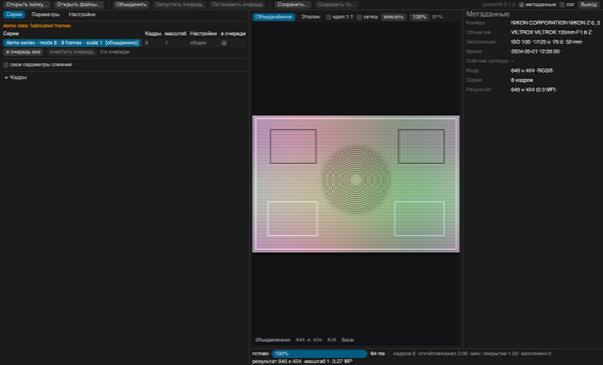
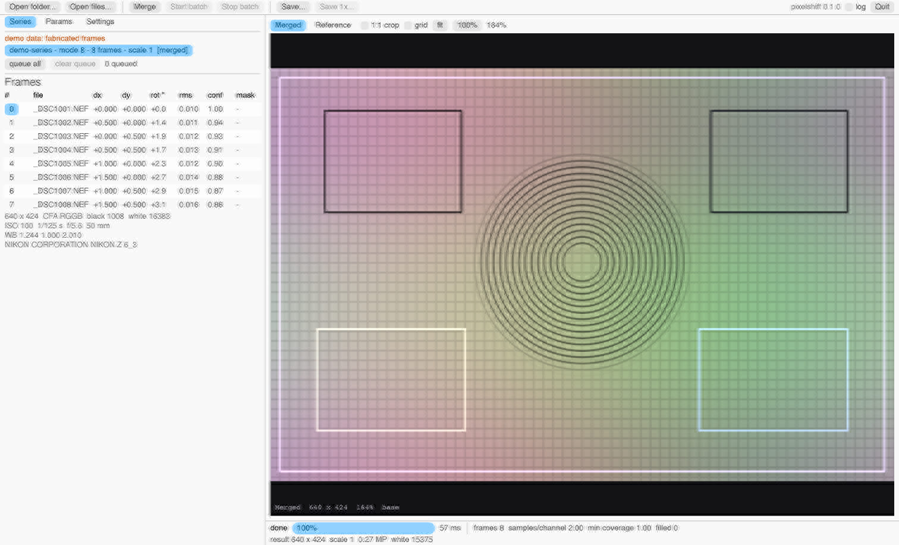
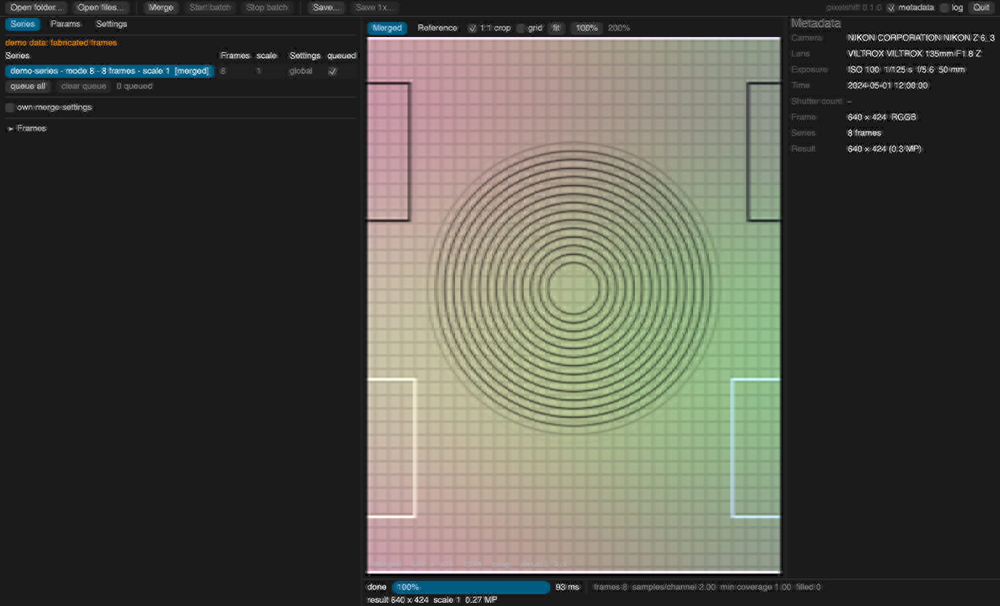
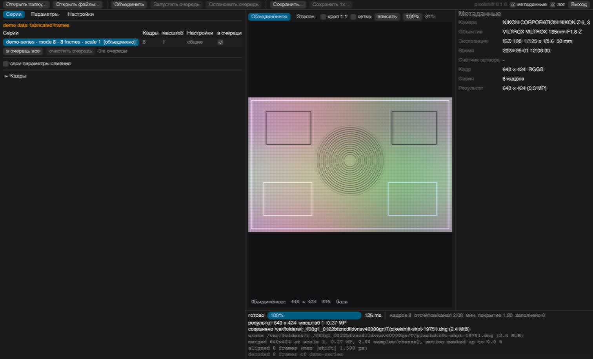

# nikon-pixelshift-rust

Слияние серий Nikon Pixel Shift в линейное изображение высокого разрешения с записью в
стандартный контейнер (DNG или 16-битный TIFF), пригодный для дальнейшей обработки в
сторонних RAW-редакторах.

Pixel Shift — режим, в котором камера снимает несколько кадров со сдвигом матрицы на доли
пикселя. Программа измеряет эти сдвиги по содержимому кадров, реконструирует изображение на
сетке повышенной плотности и записывает результат; сторонние редакторы получают файл без
обращения к фирменному конвертеру.

Состояние: рабочий инструмент. Проверено на сериях Nikon Z6 III (режимы 4, 8, 16 и 32 кадра,
объективы с существенно разной дисторсией). Декодирование сырья выполняет LibRaw, поэтому
список поддерживаемых камер и объективов определяется его базой; автоопределение серий
реализовано для файлов Nikon NEF.

## Скриншоты


*Тёмная тема и русский интерфейс: серии, таблица кадров со сдвигами и доверием, параметры слияния.*


*Светлая тема и английский интерфейс; язык, тема и шрифт переключаются в меню «Настройки» без перезапуска.*


*Крупный кроп демо-кадра при зуме 2×: сетка, концентрические кольца и штриховые линейки по нижней и левой кромкам — это полные пиксели результата.*
*Догрузка детализации видимой области в полном разрешении относится к реальной серии; у демо-кадра 640×424 превью и так полного разрешения.*


*Сохранение результата: подписи и статус по-русски, а строки лога (`wrote`, `merged`, `aligned`, `decoded`) остаются английскими.*


*Панель дисторсии с ненулевым k1: прямые линии в кадре искривлены радиальной моделью.*

## Возможности

- Режимы 4 / 8 / 16 / 32 кадра. Выход 1× (полный RGB в каждом пикселе) или 2× (вчетверо
  больше пикселей) в зависимости от режима; масштаб можно задать принудительно.
- Компенсация движения (опционально): области, где кадр расходится с опорным после
  выравнивания, замаскировываются и сливаются из опорного кадра — без призраков.
  В зоне движения результат выглядит как резкий одиночный кадр, фон сохраняет
  полное разрешение слияния. Помимо разности с опорным кадром детектор сравнивает
  кадры, разнесённые по времени (четверть серии и полная длина), поэтому ловит и
  медленное движение; порог учитывает остаточную ошибку выравнивания, чтобы тряска
  не выглядела движением сцены.
- Электронная стабилизация (опционально): выход обрезается до пересечения всех
  выровненных кадров. Съёмка с рук даёт чуть меньший (на пиксели смещений), но
  корректно объединённый кадр вместо полного по размеру, но с разъехавшимися краями.
- Выравнивание для больших смещений: пирамидальный поиск глобального сдвига
  (до ±256 сенсорных пикселей) с проверкой кандидатов по всему полю и RANSAC-консенсус
  окон — окна, попавшие на движущийся объект, не уводят оценку. Ручные серии
  (смещения до ~27 px за кадр, повороты до 700″) выравниваются с остатком 0.2–0.6 px.
- Субпиксельное выравнивание кадров относительно опорного: перенос и поворот, оценка по
  сетке окон с отбраковкой по текстуре и остатку, доверие на кадр.
- Нормированная реконструкция по цветовым плоскостям; повторяющиеся позиции режимов 8/32
  усредняются (шумоподавление), дубли можно отключить.
- Компенсация ядра реконструкции (деконволюция) с ограничителями шума и звона.
- Выход: DNG с линейным RGB, DNG с мозаикой Байера или 16-битный TIFF (sRGB либо линейный);
  необязательное сжатие без потерь — lossless JPEG в DNG, AdobeDeflate с предиктором в TIFF.
- Линзовые метаданные и копия maker note исходного файла: редактор может применить
  собственный профиль объектива.
- Коррекция дисторсии: коэффициенты радиальной модели вручную либо автоматический подбор по
  эталонному изображению.
- Интерфейсы: CLI и GUI (egui/eframe) — пакетная очередь, вкладки «Серии / Параметры /
  Настройки», drag-and-drop папок и файлов, многоступенчатые превью (пирамида шагов 1/2/4/…,
  каждая ступень не крупнее окна), сетка поверх превью для ручной коррекции дисторсии.
- Оформление GUI: тёмная и светлая темы либо следование системной теме; стили —
  редактируемые JSON-файлы (весь вид egui + цвета канваса), загружаемые и переключаемые
  в настройках; системный шрифт ОС с откатом на встроенный, если системный шрифт не найден.
- Языки интерфейса: English, Русский, 简体中文, 日本語; автовыбор по системной локали
  (`ru-*`, `zh-*`, `ja-*`, иначе английский). Для китайского и японского переводится
  каталог подписей, отсутствующие строки откатываются на английский. Строки лога и
  сообщения об ошибках остаются английскими.
- Настройки интерфейса (язык, тема, шрифт) применяются сразу и сохраняются между запусками.

## Как это работает

1. **Декодирование.** Каждый NEF читается через LibRaw (тонкий C-шим): активная область,
   чёрный уровень, CFA, баланс белого, цветовые матрицы, параметры объектива.
2. **Выравнивание.** Сдвиг и поворот кадра относительно опорного оцениваются на
   CFA-фазо-инвариантной проекции мозаики (сумма блоков 2×2 на решётке шага 2) по сетке
   окон; субпиксельное уточнение — Гаусс—Ньютон по градиентам.
3. **Реконструкция.** Каждый отсчёт кадра переносится в точку выходной сетки и раскладывается
   по соседним пикселям в аккумулятор своей цветовой плоскости; результат — отношение
   накопленной суммы к сумме весов. Покрытие контролируется, непокрытые пиксели
   перестраиваются по соседям.
4. **Компенсация ядра.** Постфильтр компенсирует размытие, вносимое раскладкой: коэффициент
   калибруется по измеренному отклику ядра, усиление шума и звон ограничены.
5. **Запись.** DNG (`linearraw` / `cfa` / `rgb`) либо TIFF; метаданные камеры и объектива,
   встроенные превью. Сжатие без потерь: DNG — lossless JPEG (Compression = 7, как в самих
   NEF), TIFF — AdobeDeflate с горизонтальным предиктором.

## Сборка

Требования: Rust (edition 2021, проверено на 1.99), LibRaw 0.22 или новее, pkg-config,
C-компилятор (crate `cc`).

`build.rs` ищет библиотеку через pkg-config (пакет `libraw_r`), компилирует C-шим и линкует
LibRaw. Флаги линковки берутся из `.pc`-файла, при этом `-lstdc++` / `-lc++`
отфильтровываются (обход macOS, где libstdc++ отсутствует); при сборке GNU-инструментарием
его нужно вернуть вручную через `RUSTFLAGS`.

```sh
cargo build --release
target/release/pixelshift --help
```

### Linux

```sh
sudo apt install libraw-dev pkg-config build-essential   # Debian / Ubuntu
# sudo dnf install LibRaw-devel pkgconf gcc              # Fedora
```

### macOS

```sh
brew install libraw pkg-config
```

### Windows

LibRaw не распространяется одним пакетом, эквивалентным `brew`/`apt`. Возможные пути:

- **vcpkg + MSVC (рекомендуется).** Visual Studio Build Tools с рабочей нагрузкой C++,
  `rustup default stable-msvc`, `choco install pkgconfiglite`,
  `vcpkg install libraw:x64-windows`; далее
  `PKG_CONFIG_PATH=<vcpkg>/installed/x64-windows/lib/pkgconfig` и каталог `bin` этого триплета
  в `PATH` (DLL нужны и при запуске). Статический триплет неудобен: pkg-config без `--static`
  не отдаёт транзитивные зависимости.
- **MSYS2 + GNU-инструментарий.** `pacman -S mingw-w64-x86_64-libraw
  mingw-w64-x86_64-pkgconf mingw-w64-x86_64-gcc`, `rustup default stable-x86_64-pc-windows-gnu`,
  сборка в оболочке MINGW64 с `RUSTFLAGS=-C link-arg=-lstdc++`; рядом с исполняемым файлом
  нужны `libraw_r.dll`, `libgcc_s_seh-1.dll`, `libstdc++-6.dll`, `libwinpthread-1.dll`,
  `libgomp-1.dll`.
- **LibRaw из исходников.** Сборка CMake с `-DENABLE_EXAMPLES=OFF -DENABLE_OPENMP=OFF` и
  минимальный `libraw_r.pc` (`Libs: -L${libdir} -lraw_r`), на который указывает
  `PKG_CONFIG_PATH`.

Инструментарии не смешиваются: библиотеки и DLL, собранные MinGW, не линкуются в MSVC-сборку.
Если pkg-config не находит пакет, проверяется `pkg-config --libs libraw_r`: путь в
`PKG_CONFIG_PATH` должен указывать на каталог с `libraw_r.pc` (на Windows разделитель — `;`).

## Использование: CLI

```
pixelshift merge   <INPUT...> [OPTIONS]
pixelshift inspect <INPUT...> [OPTIONS]
pixelshift gui     [--selftest] [--demo] [--lang auto|en|ru]
                   [--theme auto|dark|light] [--font system|builtin]
                   [--distort K1[,K2[,K3]]] [--shot PATH] [--shot-zoom FACTOR]
                   [--shot-crop X,Y,W,H] [--shot-source merged|reference]
                   [--shot-save] [--shot-timeout SECS] [--shot-log] [INPUT...]
```

`INPUT` — каталог с серией (серии определяются автоматически по именам файлов) либо явный
список NEF. Прогресс выводится в stderr, сводка — в stdout, код возврата 1 при ошибке.

Флаги `merge`:

| Флаг | Назначение |
|---|---|
| `--out PATH` | выходной файл (одна серия) или каталог (несколько серий) |
| `--scale auto\|1\|2` | плотность выходной сетки; `auto` = 1 для 4/8 кадров, 2 для 16/32 |
| `--format dng\|tiff` | контейнер |
| `--dng-flavor linearraw\|cfa\|rgb` | вариант основного изображения DNG |
| `--tiff-render` / `--tiff-linear` | TIFF в sRGB либо в родных линейных данных (по умолчанию sRGB) |
| `--deconvolve 0..2` | сила компенсации ядра реконструкции (по умолчанию 1.0) |
| `--distort K1[,K2[,K3]]` | коэффициенты радиальной дисторсии (по умолчанию 0) |
| `--distort-fit PATH` | подобрать коэффициенты по эталонному изображению; несовместим с `--distort` |
| `--compression none\|lossless` | сжатие без потерь: lossless JPEG в DNG, AdobeDeflate+предиктор в TIFF |
| `--also-1x` | дополнительно записать результат в масштабе 1× |
| `--no-align` | не оценивать сдвиги (кадры считаются совмещёнными) |
| `--motion` | включить компенсацию движения (детекция расхождений с опорным кадром и между кадрами, разнесёнными по времени) |
| `--stabilize` | электронная стабилизация: кроп выхода до пересечения всех выровненных кадров |
| `--motion-sensitivity F` | чувствительность маски движения, 0.25..4 (больше — маскирует больше; 1.0 по умолчанию) |
| `--no-makernote` | не копировать maker note исходного файла в DNG |
| `--threads N` | число рабочих потоков |
| `--quiet` | без строк прогресса |

`inspect` печатает камеру, геометрию кадра, CFA, уровни, баланс белого, экспозицию,
определённый режим и масштаб, измеренные сдвиги/поворот/остаток по кадрам, параметры
объектива, ожидаемый размер выхода и свободное место на томе. Флаги `--distort` (та же
радиальная модель, что у `merge`) и `--no-align` показывают, что даст слияние с этими
параметрами.

## Использование: GUI

- Вкладка «Серии»: таблица очереди — источник, число кадров, масштаб выхода, чьи
  настройки будут применены (свои ★ / общие) и чекбокс «выполнять» (снятая серия
  пропускается пакетной обработкой; «в очередь все» набирает только отмеченные).
  Таблица кадров (сдвиг, поворот, остаток, доверие, маска) свёрнута по умолчанию.
- Свои параметры слияния: у любой серии можно закрепить снимок текущих настроек —
  очередь и ручное слияние будут использовать его вместо общих, поэтому длинный пакет
  смешанных сюжетов идёт без присмотра.
- Вкладка «Параметры»: масштаб, контейнер и его вариант, сжатие, дополнительный выход 1×,
  режим выравнивания, число потоков, деконволюция, коэффициенты дисторсии (k1, k2, k3),
  кнопка подбора дисторсии по эталонному файлу.
- Вкладка «Настройки»: язык, тема, шрифт (раньше это было меню верхней панели).
- Папку или NEF-файлы можно перетащить в окно — серии распознаются автоматически.
  Пока серии не загружены, вся область превью — крупное поле перетаскивания.
- Справочная панель «Метаданные» (тумблер в верхней панели): камера, объектив,
  экспозиция, время съёмки и счётчик затвора последнего кадра серии.
- Превью: сразу после открытия папки канвас показывает первый кадр каждой серии
  («стоит ли склеивать?») с пометкой у нижней кромки; после слияния — результат.
  Зум и панорамирование; при увеличении видимая область догружается ступенями
  (1/2, 1/4, … от полного разрешения, каждая ступень не крупнее окна), поэтому на любом
  зуме видно реальное качество. Чекбокс «Сетка» (и просто движение ползунков дисторсии)
  рисует поверх превью прямые линии — по ним удобно выравнивать кривые линии кадра.
- Пакетная очередь, индикация стадий и таймингов в человекочитаемом формате
  (4.5 с, 5 мин 20.0 с), сохранение через системный диалог.

### Настройки и флаги

Меню «Настройки» в правой части верхней панели: язык (English / Русский), тема (системная,
тёмная, светлая) и шрифт (системный, встроенный). Выбор применяется к открытому окну сразу —
тема и шрифт устанавливаются до первого кадра, поэтому тёмное окно не мигает светлым, — и
сразу записывается в файл настроек; отдельной кнопки сохранения нет.

Файл настроек (RON, ключ `ui_prefs`) создаёт eframe рядом с остальными данными приложения:

| ОС | Путь |
|---|---|
| macOS | `~/Library/Application Support/pixelshift/app.ron` |
| Linux | `~/.local/share/pixelshift/app.ron` (при заданном `XDG_DATA_HOME` — `$XDG_DATA_HOME/pixelshift/app.ron`) |
| Windows | `%APPDATA%\pixelshift\data\app.ron` |

Флаги `--lang`, `--theme` и `--font` действуют только на текущий запуск: они не записываются
в файл настроек и не перекрывают сохранённый выбор, поэтому следующий запуск без флагов
восстанавливает то, что было выбрано в меню.

### Стили

Весь вид приложения (цвета egui, отступы, скругления, виджеты + палитра канваса: фон,
поле перетаскивания, сетка, служебные подписи) хранится в JSON-файлах стилей. При первом
запуске в каталоге стилей создаются `dark.json` и `light.json` — точные копии прежнего
встроенного вида, готовые к ручной правке.

| ОС | Каталог стилей |
|---|---|
| macOS | `~/Library/Application Support/pixelshift/styles/` |
| Linux | `~/.local/share/pixelshift/styles/` (или `$XDG_DATA_HOME/pixelshift/styles/`) |
| Windows | `%APPDATA%\pixelshift\data\styles\` |

В настройках (вкладка «Настройки»): выпадающий список «Стиль» — встроенные Dark/Light и
все файлы из каталога; «Загрузить стиль...» копирует выбранный JSON в каталог стилей и
включает его; «Экспортировать текущий...» сохраняет активный стиль в файл для правки.
Загруженный стиль замещает встроенный вид целиком (файл описывает и тёмную, и светлую
семантику через поле `dark`) и сохраняется между запусками. Повреждённый файл не мешает
запуску: он пропускается с сообщением в лог.

Флаги `gui`:

| Флаг | Назначение |
|---|---|
| `--selftest` | прогнать конечный автомат без окна (используется в приёмочных проверках) |
| `--demo` | открыть окно на синтетических данных |
| `--lang auto\|en\|ru` | язык интерфейса на запуск; `auto` — по системной локали |
| `--theme auto\|dark\|light` | тема на запуск; `auto` — системная |
| `--font system\|builtin` | шрифт на запуск; системный при недоступности откатывается на встроенный |
| `--distort K1[,K2[,K3]]` | коэффициенты радиальной дисторсии на запуск; в настройках не сохраняются |
| `--shot PATH` | после слияния записать окно в JPEG по `PATH` и выйти — режим, которым собраны скриншоты выше |
| `--shot-zoom FACTOR` | зум холста для снимка; `1.0` — один пиксель результата на точку |
| `--shot-crop X,Y,W,H` | область результата, показываемая в снимке кропом 1:1 (в пикселях результата) |
| `--shot-source merged\|reference` | что показывает превью в снимке: результат слияния или опорный кадр |
| `--shot-save` | записать результат во временный файл до снимка, чтобы строка лога о сохранении попала в кадр |
| `--shot-timeout SECS` | сколько секунд ждать слияния и кадра перед ошибкой (по умолчанию 20) |
| `--shot-log` | снимок с раскрытой панелью лога |

Набор снимков для раздела «Скриншоты» собирает `tools/screenshots.sh`.

## Форматы вывода

| Вариант | Содержимое | Совместимость |
|---|---|---|
| `linearraw` (по умолчанию) | линейный RGB 16 бит, полное цветовое разрешение | LibRaw-инструменты, rawler, Adobe DNG-путь, ImageIO |
| `cfa` | мозаика Байера 16 бит (RGGB), редактор демозаицирует сам | максимальная: обычный Bayer-DNG для любых RAW-редакторов; теряется цветовое разрешение |
| `rgb` | RGB 16 бит, если редактор не принимает linearraw | экспериментальный: проверенные локально читатели его не принимают |
| `--format tiff --tiff-render` | 16 бит sRGB, баланс белого и матрица применены | универсальный, но это уже не RAW |
| `--format tiff --tiff-linear` | 16 бит, родные линейные данные камеры | когда нужны именно линейные данные без DNG-метаданных |

Выбор варианта — компромисс между полнотой данных и поддержкой конкретного редактора;
подробности и матрица проверенных читателей — в `docs/COMPATIBILITY.md`.

## Дисторсия

Геометрия результата соответствует геометрии исходных кадров: программа не применяет
оптическую коррекцию, если её не попросили. Компенсация выполняется радиальной моделью
Брауна `r' = r·(1 + k1·r² + k2·r⁴ + k3·r⁶)`, где `r` нормирован на половину диагонали кадра,
поэтому коэффициенты не зависят от масштаба выхода.

Коэффициенты задаются вручную либо подбираются по эталонному изображению: результат
сопоставляется с эталоном блок за блоком (пирамидальная нормированная кросс-корреляция и
субпиксельное уточнение), затем методом наименьших квадратов оцениваются сдвиг и `k1..k3`.
Эталон — файл, в котором коррекция уже выполнена средствами редактора или конвертера
(16-битный TIFF либо любой RAW, читаемый LibRaw).

Ограничения модели: старшие члены обусловлены хуже младших (различимы только при наличии
данных у самой кромки кадра), поэтому критерием качества подбора служит остаток
среднеквадратичного отклонения, а не совпадение отдельных коэффициентов; тангенциальные
составляющие пока не моделируются.

Кроме того, в DNG записываются линзовые EXIF-теги и копия maker note исходного файла (`--no-makernote`
отключает): часть редакторов применяет собственный профиль объектива по этим данным.
Для контейнеров, где редактор профиль не подставляет, используется запекание геометрии при
слиянии (см. выше).

## Верификация

Качество измеряется относительно эталонного результата, полученного другим конвертером из тех
же кадров: сравниваются геометрия (остаточный сдвиг), корреляция яркости и каналов, СКО после
подгонки усиления и энергия высоких частот на участках с текстурой; отдельно считается
прирост относительно одиночного кадра, увеличенного в 2 раза, — он показывает, является ли
результат реконструкцией, а не интерполяцией.

Инструменты измерений — `tools/` (`validate.py`, `resolution.py`, `accept.sh` и вспомогательные
скрипты); методика и результаты — `docs/VERIFICATION.md`.

Скриншоты в разделе «Скриншоты» пересобираются командой `bash tools/screenshots.sh`: окно
открывается на демо-данных, реальные серии и снимки для этого не нужны. Съёмка идёт с живого
окна, поэтому нужен графический сеанс: без него `--shot` не получит кадр и завершится по
таймауту с кодом 1.

## Ограничения

- Выравнивание жёсткое (сдвиг + поворот). Остаточная недокомпенсация тряски с рук
  (0.2–0.6 px, от rolling shutter при повороте) делает ручные серии чуть мягче
  штативных; сеточная коррекция (ShiftGrid) — кандидат на включение.
- В замаскированных зонах цветовое разрешение опускается до байеровского (одиночный
  кадр); деконволюция там автоматически отключается пропорционально доле замаскированных
  кадров, чтобы не подчёркивать структуру демозаика и хроматические каёмки.
- Сдвиги кадров должны укладываться в единицы пикселей; при сильном шуме или низком контрасте
  оценка может быть неустойчивой (`--no-align`, таблица кадров в GUI).
- Без сжатия размер выхода ≈ 6 байт на пиксель (сотни мегабайт для режимов 16/32 кадра);
  `--compression lossless` уменьшает файл примерно вдвое, а на гладких сценах сильнее.
- Поддержка камер ограничена базой LibRaw; автоопределение серий — только для NEF.
- macOS ImageIO (Preview, `sips`) не отображает `linearraw` корректно: для просмотра
  используются `cfa` или TIFF.
- Capture One не применяет «Manufacturer Profile» к сторонним DNG, поэтому коррекцию
  объектива приходится запекать (`--distort` / `--distort-fit`).

## Что предстоит реализовать

1. Тангенциальная дисторсия (`p1`, `p2`) и профили «объектив + фокусное расстояние» с
   автоматической подстановкой.
3. Извлечение фирменных данных коррекции объектива из maker note (сейчас он копируется как
   есть, но не декодируется).
4. Реконструкция с неотрицательным ядром и регуляризованным решением на нерегулярной решётке:
   это должно сократить остаточный разрыв с эталонными конвертерами на режимах 16/32 кадра.
5. DNG-опкоды (`OpcodeList2`, WarpRectilinear) как неразрушающая альтернатива запеканию
   геометрии — для редакторов, которые их поддерживают.
6. Пресеты и пакетная обработка по объективам и фокусным; параметры слияния между сессиями
   пока не сохраняются (сохраняются только настройки интерфейса).
7. Расширение автоопределения серий за пределы NEF и Nikon.
8. CI (GitHub Actions) для Linux, macOS и Windows, готовые сборки.
9. Регрессионные тесты на большем числе камер и объективов, включая автоматическое сравнение
   с эталонным конвертером.

## Структура проекта

```
src/rawio/     декодирование через LibRaw и C-шим
src/shift.rs   выравнивание (перенос + поворот)
src/merge.rs   реконструкция на выходной сетке
src/distort.rs радиальная модель дисторсии и пересэмплирование
src/fit.rs     подбор коэффициентов по эталонному изображению
src/write/     DNG, TIFF, JPEG-превью
src/app/       графический интерфейс (egui)
src/cli.rs     командная строка
shim/          C-шим над LibRaw
tests/         юнит- и интеграционные тесты
tools/         скрипты верификации
docs/          архитектура, совместимость, верификация
```

## Тесты

```sh
cargo test            # юнит- и интеграционные тесты
cargo test --lib      # только юнит-тесты, без внешних утилит и данных
```

Часть интеграционных тестов использует внешние утилиты (LibRaw CLI, libtiff, ImageMagick) и
реальные серии кадров; при их отсутствии такие тесты падают либо пропускаются — это не влияет
на работу самой программы.

## Документация

- `docs/ARCHITECTURE.md` — устройство, принятые решения, измеренные свойства серий.
- `docs/COMPATIBILITY.md` — форматы вывода, матрица читателей, ограничения редакторов.
- `docs/VERIFICATION.md` — методика и результаты измерений.

## Лицензия

MIT (см. `LICENSE`).
